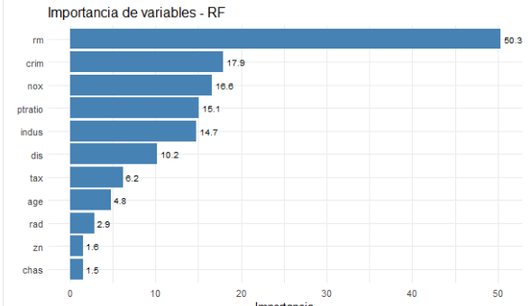
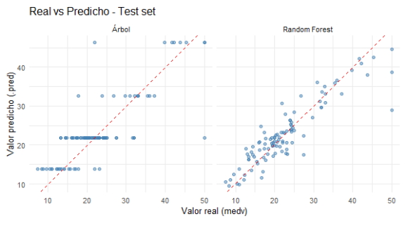
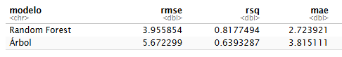

El conjunto de datos Boston contiene información del Censo de EE.UU. sobre el mercado inmobiliario en la zona de Boston. **Boston Housing** contiene información de 506 secciones censales del área metropolitana de Boston, Massachusetts, recopilada originalmente a partir del Censo de EE. UU. de 1970 y publicada por David Harrison y Daniel L. Rubinfeld en 1978

1 Cargue el conjunto de datos Boston y divida los mismos en un 80%

```{r}
library(tidyverse)
library(tidymodels)
# Cargar el archivo .RData
library(MASS)
data(Boston)
```

```{r}
set.seed(123)
boston_split <- initial_split(Boston, prop = 0.8)
boston_train <- training(boston_split)
boston_test  <- testing(boston_split)
```

2 Diseñe una receta de preprocesamiento especificando la fórmula medv

```{r}
library(themis)
boston_reci <- recipe(medv ~ crim + zn + indus + chas + nox + rm + age + dis + rad + tax + ptratio + lstat, 
                      data = boston_train)   |> 
  step_dummy(all_nominal_predictors())
tidy(boston_reci) 
```

3 Defina un modelo de regresión basado en un Árbol de regresión individual

```{r}
boston_arbol <- decision_tree(
  tree_depth = 2,        # Limita la profundidad para mantenerlo explicable
  min_n = 10,            # Mínimo de observaciones en un nodo para dividir
  cost_complexity = 0.01 # Parámetro de complejidad (cp)
)  |> 
  set_engine("rpart") |>
  set_mode("regression")
```

4 Ajuste el flujo de trabajo del Árbol sobre el conjunto de entrenamiento

```{r}
# Workflow
wf_arbol <- workflow() |>
  add_recipe(boston_reci) |>
  add_model(boston_arbol)
```

```{r}
#Ajuste 
arbol_fit <- fit(wf_arbol, data = boston_train)

predicciones_train <- predict(arbol_fit, boston_test)  |> 
  bind_cols(predict(arbol_fit, boston_test)) |> 
  bind_cols(boston_test)
```

5 Visualice la estructura del árbol resultante empleando la librería rpart.plot.

```{r}
library(rpart.plot)
arbol_engine <- extract_fit_engine(arbol_fit)

rpart.plot(
  arbol_engine,  type = 2,  extra = 101, 
  shadow.col = "gray",  nn = TRUE,
  main = "Árbol de Decisión para valor mediano de las viviendas")
```

Identifique la variable seleccionada en el nodo raíz (root node) y analice su importancia.

RTA: la variable nodo raìz es rm: Número medio de habitaciones por vivienda. El algoritmo `rpart` evalúa **todas las variables** y elige la que **mejor separa** los valores de `medv` en dos grupos lo más homogéneos posible. *La primera división en `rm = 6.9` separa viviendas con menos habitaciones (predicción 15–23 mil USD) de viviendas con más habitaciones (33–46 mil USD). Esta variable fue elegida por el algoritmo porque produce la mayor reducción de impureza al dividir la muestra: las viviendas con menos de 6.9 habitaciones (86% de los casos) tienen un valor medio predicho de 20 mil USD, mientras que las de 6.9 o más (14%) alcanzan los 38 mil USD. La diferencia de 18 mil USD indica que `rm` es el predictor más fuerte del valor medio de la vivienda en este subconjunto de Boston*

```{r}
library(ggplot2)

boston_train %>%
  ggplot(aes(x = rm, y = medv, colour = factor(cut(lstat, breaks = 2)))) +
  geom_point(alpha = 0.7) +
  labs(
    x = "Número medio de habitaciones (rm)",
    y = "Valor medio de la vivienda (medv)",
    colour = "lstat"
  ) +
  geom_vline(xintercept = 6.9, linetype = "dashed", colour = "black") +
  geom_hline(yintercept = 23, linetype = "dashed", colour = "black")
```

Tengo la siguiente inquietud. El concepto de nivel socio economico es un análisis en si mismo... ¿què pasarìa si lo eliminamos de la receta?


*el árbol reemplazó esa división por `nox` (concentración de óxido nítrico), manteniendo la estructura general: primero separa por tamaño (`rm`), luego por calidad del entorno. Me parece un análisis mucho más interesante.*

**PD:** hay una variable que ese llama "black". En teoría **Representa la proporción de población afroamericana por localidad**.

Según la búsqueda en internet:

Se calcula mediante la siguiente fórmula matemática:\
**B = 100 × (Bk - 0.63)²**

La fórmula utiliza una transformación cuadrática respecto al valor de referencia `0.63`. Esto significa que el valor de la variable aumenta tanto si la proporción de población negra es muy baja como si es muy alta respecto a ese umbral, lo que complica su interpretación lineal directa.

Problemas éticos y obsolescencia**:** Hoy en día, este conjunto de datos está **obsoleto y desaconsejado** en la comunidad de ciencia de datos

6.  Especifique un modelo Random Forest compuesto por 500 árboles, habilite la estimación de la importancia de variables por permutación.

```{r}
rf_spec <- rand_forest(
  mtry = (3),
  trees = 500,
  min_n = (5)
) |> 
  set_engine("ranger", importance = "permutation") |> 
  set_mode("regression")

# 4. Crear Workflow
rf_wf <- workflow() |> 
  add_recipe(boston_reci) |> 
  add_model(rf_spec)
```

7.  Ajuste el workflow Random Forest sobre el conjunto de entrenamiento.

```{r}
rf_fit <- fit(rf_wf, data = boston_train)
```

8.  Extraiga y grafique la importancia de las variables.

    ```{r}
    library(vip)

    rf_engine <- extract_fit_engine(rf_fit)
    importancia <- rf_engine$variable.importance
    library(ggplot2)

    library(ggplot2)

    data.frame(
      variable = names(importancia),
      valor = as.numeric(importancia)
    ) |>
      ggplot(aes(x = reorder(variable, valor), y = valor)) +
      geom_col(fill = "steelblue") +
      geom_text(aes(label = round(valor, 1)), hjust = -0.2, size = 3) +
      coord_flip() +
      labs(x = NULL, y = "Importancia", title = "Importancia de variables - RF") +
      theme_minimal()
    ```

Las dos variables más importantes siguen siendo lstat y rm, pero con distinta ponderacion

9.  Genere las predicciones sobre el conjunto de prueba (test set) para ambos modelos.

```{r}
pred_arbol <- predict(arbol_fit, boston_test) |>
  bind_cols(boston_test["medv"])

pred_rf <- predict(rf_fit, boston_test) |>
  bind_cols(boston_test["medv"])
```

10 Calcule e interprete las métricas de evaluación RMSE, MAE y R2 tanto para el Arbol individual como para el Random Forest.

```{r}
metrics(pred_arbol, truth = medv, estimate = .pred)
metrics(pred_rf, truth = medv, estimate = .pred)

dplyr::bind_rows(
  metrics(pred_arbol, truth = medv, estimate = .pred) |> mutate(modelo = "Árbol"),
  metrics(pred_rf,    truth = medv, estimate = .pred) |> mutate(modelo = "Random Forest")
) |>
  dplyr::select(modelo, .metric, .estimate) |>
  pivot_wider(names_from = .metric, values_from = .estimate) |>
  arrange(modelo)
```

Intrepretación: En el modelo de Arbol el error promedio es mayor y la proporción de la varianza es menor, por lo que el modelo de Random Forest es más preciso para realizar predicciones

11. Elabore un gráfico de dispersión de Valores Reales vs. Predichos en el conjunto de prueba para comparar visualmente ambos modelos

    ```{r}

    bind_rows(
      pred_arbol |> mutate(modelo = "Árbol"),
      pred_rf    |> mutate(modelo = "Random Forest")
    ) |>
      ggplot(aes(x = medv, y = .pred)) +
      geom_point(alpha = 0.5, colour = "steelblue") +
      geom_abline(slope = 1, intercept = 0, linetype = "dashed", colour = "red") +
      facet_wrap(~modelo) +
      labs(x = "Valor real (medv)", y = "Valor predicho (.pred)",
           title = "Real vs Predicho - Test set") +
      coord_equal() +
      theme_minimal()
    ```

<!-- -->

12. Compare el desempeño predictivo de ambos enfoques.

    El arbol utiliza dos nodos raiz por lo que las predicciones se agrupan en 4 niveles horizontales. Cada hoja asigna un valor constante a todas las observaciones que caen en ella, lo que limita la granularidad de las predicciones. En contraste, el Random Forest, al promediar 500 árboles, genera predicciones continuas que se ajustan mejor a los valores reales, como se refleja en la menor dispersión respecto a la diagonal (línea de predicción perfecta)

Desafío personal:

A mi "me molesta" que se tome población de bajo estatus, porque para determinar bajo estatus hay que hacer un estudio en si mismo. ¿que parametros tomaron para determinar el estatus? ingresos, educacion, cantidad de autos?

Según la descripción original del dataset, `lstat` se define como la **proporción de la población que se percibe de estatus socioeconómico bajo**. Los parámetros exactos que usaron para determinarlo son dos:

- **Adultos sin educación secundaria completa** (`adults without some high school education`).

- **Personas clasificadas como trabajadores manuales no calificados** (`classified as laborers`).

Me parece que educación + ocupación son variables ex post, por decirlo de alguna manera. teniendo mejor educacion y mejor trabajo es muy probable que se tenga mejor casa...

Asi que nuevamente voy a sacar esa variable y ver que sucede



Se considera principalmente rm (como antes) y crim (Tasa de criminalidad per cápita por ciudad). Algo que parece bastante razonable.



Las conclusiones al comparar los modelos se mantienen.

Vamos a ver las métricas



El cambio no es significativo.
